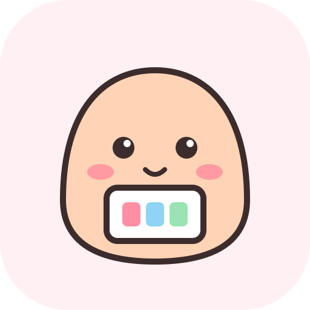

<p align="center"></p>

# bossview

A cmux board of your Claude Code sessions, sorted by what each one needs from you.

A Claude Code hook asks Haiku for a few words on what the session needs from you, plus a triage label. The board shows that on each card, newest first:

| Column | Means |
|---|---|
| **Needs you** | Blocked, waiting for approval, or asking you to decide |
| **Review** | Changed code or produced work you should check |
| **Working** | Still running |
| **Safe to close** | You got your answer, nothing pending |

Click a card to jump to its tab.

## Requirements

- macOS with cmux (Custom Sidebars beta enabled)
- Claude Code, logged in
- Node 18+

## Install

From a cmux terminal:

```sh
git clone https://github.com/gabechu/bossview.git ~/code/bossview
~/code/bossview/install.sh
```

The installer links the board into `~/.config/cmux/sidebars`, adds the hook to `~/.claude/settings.json` (backing it up first), and creates a pinned **✻ Boss** workspace with the board open. Rerunning it is safe.

Restart running Claude sessions so they pick up the hook. Keep the clone where it is: the board and the hook run from it, so `git pull` updates both.

## Use

Open the **✻ Boss** workspace. Edits to `sidebar/bossview.js` hot-reload. Hook errors go to `~/.bossview/hook.log`.

The hook runs the `claude` on your PATH; set `BOSSVIEW_CLAUDE` to use another one.

## Uninstall

```sh
rm ~/.config/cmux/sidebars/bossview.js
```

Then remove the `boss-hook.mjs` entries from `~/.claude/settings.json`, and unpin and close the **✻ Boss** workspace.
